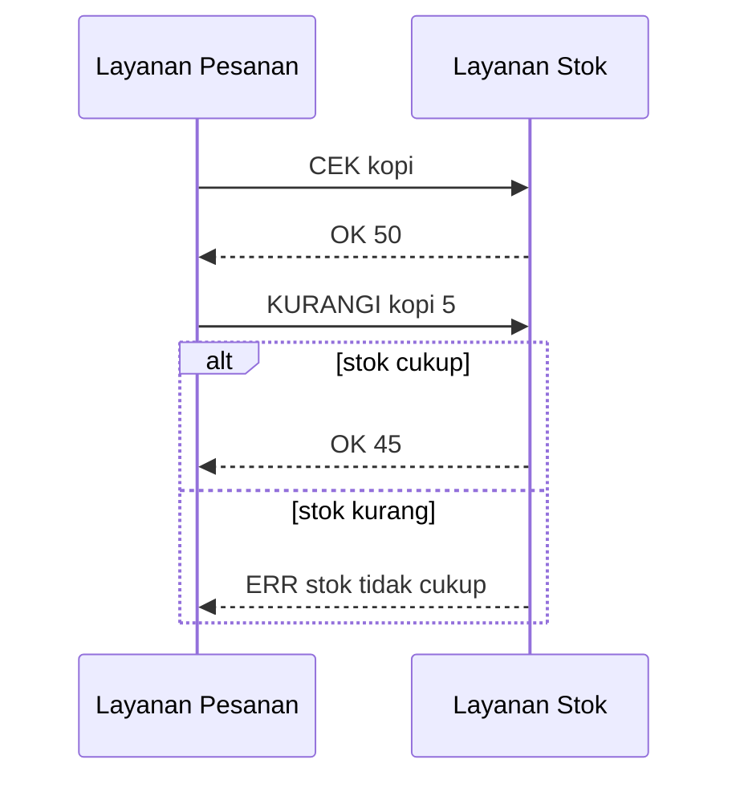

# IPC Layanan Pesanan ↔ Layanan Stok (C++)

Studi kasus: UMKM toko kopi. **Layanan Pesanan** (klien) menanyakan dan mengurangi stok
di **Layanan Stok** (server). Dua cara komunikasi diimplementasikan:

| Mode | Mekanisme | Port | Berkas server |
|------|-----------|------|---------------|
| `socket` | Message passing, TCP socket, protokol teks per baris | 9000 | `stok_socket_server.cpp` |
| `xmlrpc` | RPC: XML-RPC di atas HTTP POST (ditulis manual, tanpa library) | 8000 | `stok_xmlrpc_server.cpp` |

Klien untuk keduanya: `pesanan.cpp`. Data stok bersama + mutex: `stok.hpp`. Fungsi socket: `net.hpp`.

## Cara menjalankan di Debian (VM)

```bash
sudo apt update && sudo apt install -y build-essential
# salin folder ini ke VM, lalu:
cd ipc_umkm
make                # kompilasi
make test           # uji otomatis -> hasil_pengujian.txt
```

Manual (3 terminal, atau pakai `&`):

```bash
./stok_socket_server &            # terminal 1: layanan stok (socket)
./stok_xmlrpc_server &            # terminal 1: layanan stok (XML-RPC)
./pesanan socket cek kopi         # terminal 2
./pesanan socket pesan kopi 5
./pesanan xmlrpc pesan kopi 5
./pesanan xmlrpc pesan kopi 999   # -> GAGAL stok tidak cukup
```

Dua VM / dua mesin: jalankan server di VM A, lalu di VM B
`STOK_HOST=<ip-VM-A> ./pesanan socket pesan kopi 5`.
(Jika VM memakai NAT, ubah jaringan VirtualBox/VMware ke *Bridged* atau *Host-only*.)

## Diagram alur komunikasi

```
 Pelanggan
    │ pesan kopi x5
    ▼
┌────────────────┐   1. CEK kopi / stok.cek("kopi")        ┌─────────────────┐
│ Layanan        │ ──────────────────────────────────────▶ │ Layanan Stok    │
│ Pesanan        │ ◀────────────────────────────────────── │  - map produk   │
│ (pesanan.cpp)  │   OK 50                                  │  - mutex        │
│                │   2. KURANGI kopi 5 / stok.kurangi(...)  │ (thread per     │
│                │ ──────────────────────────────────────▶ │  koneksi)       │
│                │ ◀────────────────────────────────────── │                 │
└────────────────┘   OK 45  atau  ERR/fault (stok kurang)   └─────────────────┘
       transport A: TCP socket (port 9000)   transport B: HTTP+XML (port 8000)
```



## Contoh pesan di kabel

Socket: `KURANGI kopi 5\n` → `OK 45\n`

XML-RPC:
```xml
<methodCall><methodName>stok.kurangi</methodName><params>
  <param><value><string>kopi</string></value></param>
  <param><value><int>5</int></value></param></params></methodCall>
```
